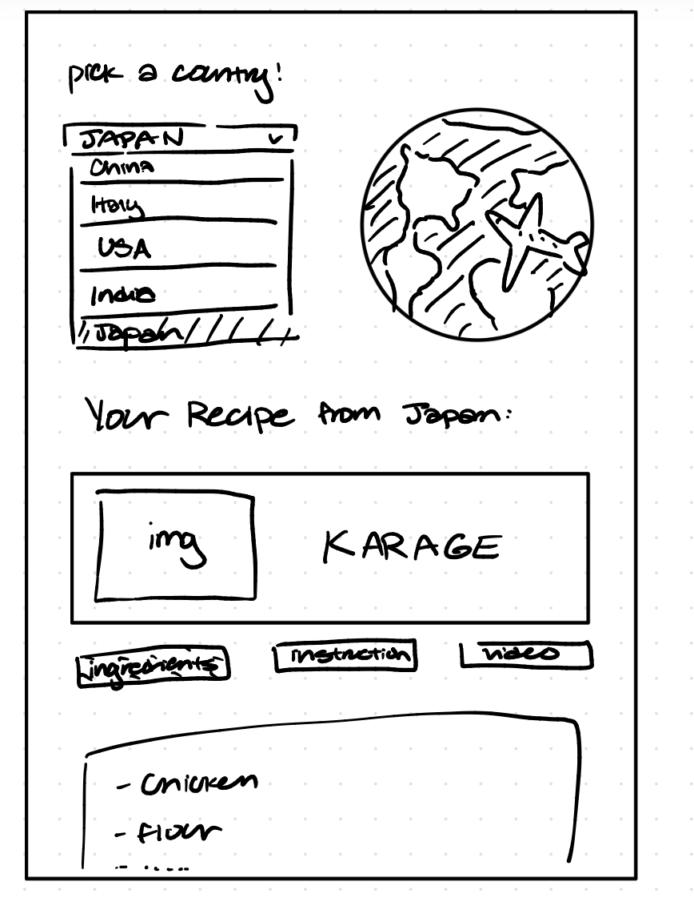
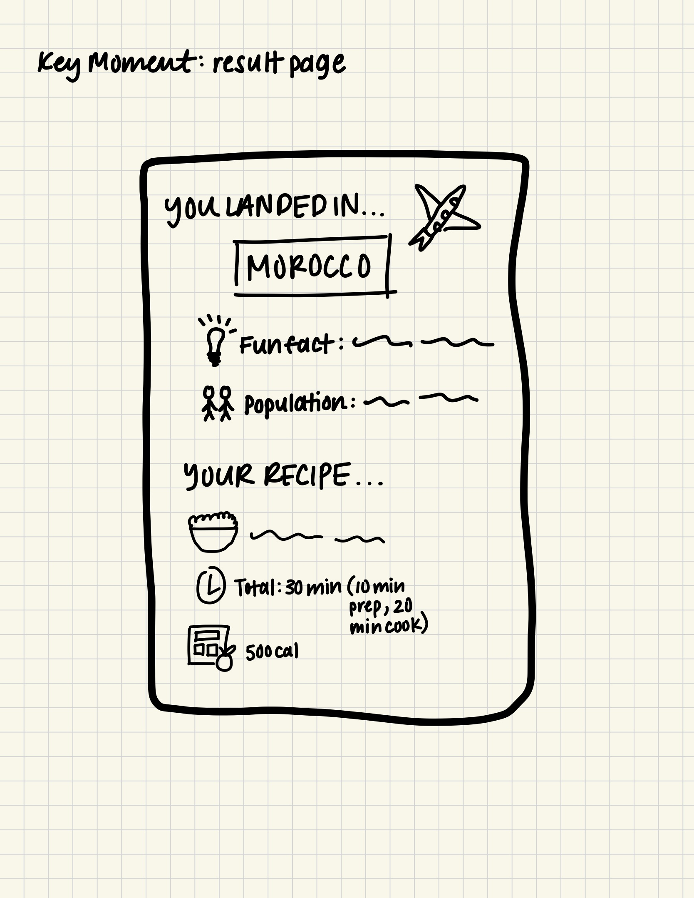
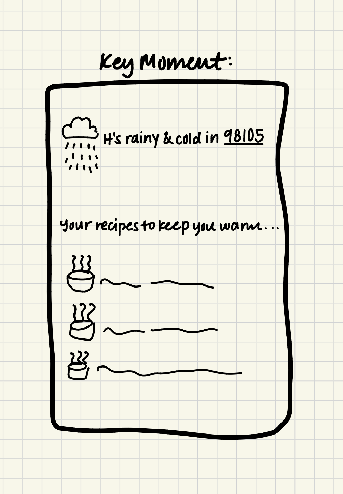
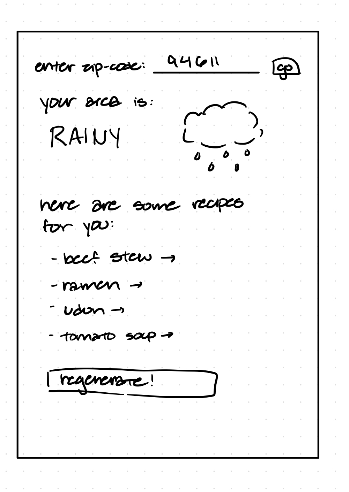
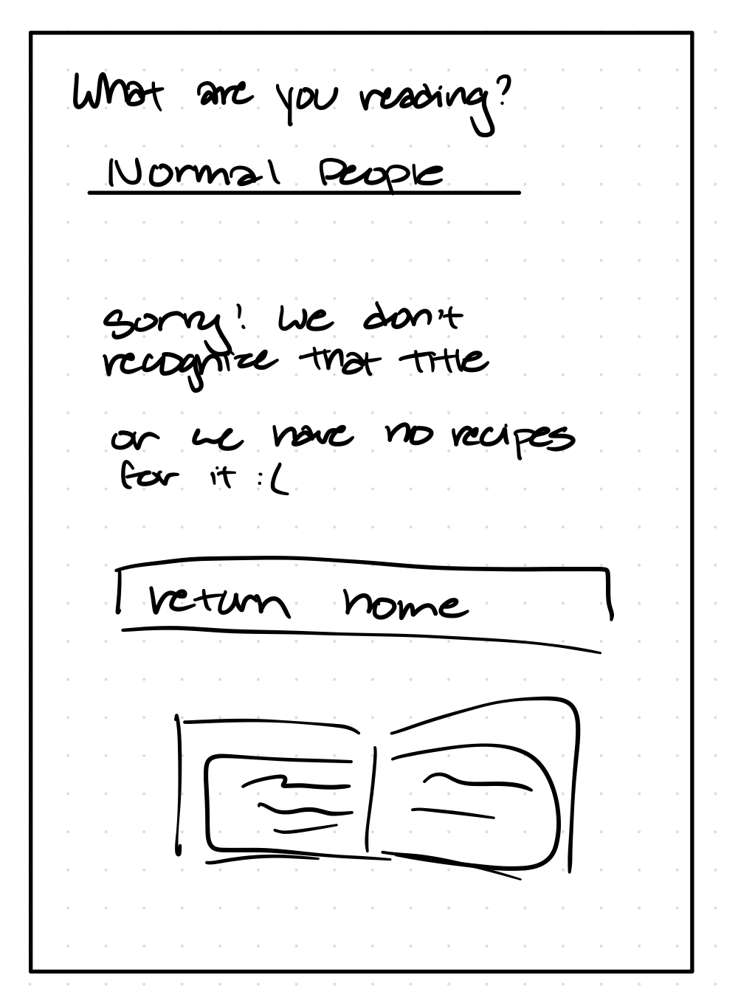

CONCEPT 1: A recipe-discovering website that helps a user discover a new cultural cuisine while also learning about that specific country. 

Sketch one of key moment: 

Sketch two of key moment: 

Who’s it for: This concept is for individuals who have issues coming up with recipe ideas to cook and also those who enjoy discovering new dishes and recipes from various cuisines.

Value (what it adds): Most recipe sites don’t really talk about the background or origin of dishes, and many geography sites don’t give the option to explore a region’s cuisine in depth. This project kills two birds with one stone, integrating all of this data right into one resource- learning about a dish and its origin while preparing it.

What data it uses: TheMealDB and RestCountriesAPI

Depth item: Many lenses (users can simultaneously discover a new recipe while learning about a new country) 

User flow: 
User will search up a country → the program will randomly pick one dish from the cuisine that originates from that region → the user can pick and filter between what they are viewing on the page (ingredients, calories, prep time, recipe, video of recipe, etc)

- If there are no dishes under a cuisine → it will give the user a message that the data doesn’t hold anything for that region → redirect the user back to the home page to search another country 

- If the user types a random string of words that the site doesn’t recognize → will show on the home screen a message that says “Sorry we don’t recognize that cuisine, please try again” 

- If there’s an API error, it will inform the user with a message

CONCEPT 2: A weather-based recipe discovery site that matches a user with recipes based on the weather of a given zip code

Sketch one of key moment: 

Sketch two of key moment: 

Who’s it for: This product is for someone who lives in the USA and wants to find a meal that fits the type or mood of the weather they are experiencing, whether it be extremely cold or a type of tropical heat.

Value (what it adds): This goes beyond a basic recipe site and tailors more to the user by connecting to something they are experiencing (the weather). It adds a level of personalization by pinpointing where a user lives that is specific to them.

What data it uses: Recipe API and OpenMeteo

Depth item: Made for a place (it’s personalized for a user’s location and the circumstances they are experiencing there)

User flow:
User will give zip code of their current location/a location → site will interpret the specific weather and connect weather forecast to meals (ex: rainy & cold → soups) → the user can pick and filter between what they are viewing on the page (ingredients, calories, prep time, recipe, video of recipe, etc)

- If the user types a random string of numbers that the site doesn’t recognize → will show on the home screen a message that says “Sorry we don’t recognize that zip code, please try again” 

- If there’s an API error, it will inform the user with a message

CONCEPT 3: A site that connects readers to dishes that bring their reading experience to life (through their taste buds) 

Sketch of key moment: 

Who’s it for: Avid readers who want to immerse themselves in the setting that they are reading about by connecting to it through food. This can help them understand the context and characterization of featured figures within the books they are reading, whether it’s nonfiction, biographical, or fictional writing.

Value (what it adds): This goes beyond researching a book’s historical background, as it provides something the reader can connect with and digest. It can also give a reader a better sense of the works they are reading and what the characters are feeling.

What data it uses: Recipe API and Google Books API

Depth item: AI step with a human check (It’s difficult to connect dishes to books and settings, but using an LLM will allow the data to be sorted and tagged in an efficient way that allows for this possibility.)

User flow: An LLM reads the description of a book and matches it to a setting, era, and Recipe API recipe, and a one-line reason → we check this connection and approve it →  a user will type in the title or author of the novel they are reading → a list of 4 recipes will be generated based on the book → the user can pick between what they are viewing on the page (ingredients, calories, prep time, recipe, video of recipe, etc.) per recipe 

- If the user types a random string of letters the site doesn’t recognize or a title the site doesn’t contain → will show a message on the home screen that says “Sorry we don’t recognize that title, please try again”

- If there’s an API error, it will inform the user with a message

